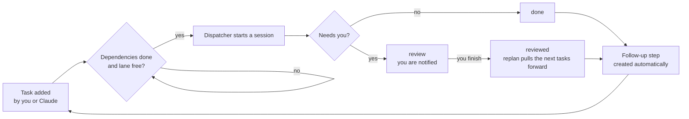

<div align="center">

# 🗓️ Claude Calendar kit

**One task calendar for all your projects, built for [Claude Code](https://claude.com/claude-code).**
Lanes, dependencies, a review queue, automatic follow-ups, and a `/next` command that tells you where you left off.


</div>

---

## ⚡ Set it up by pasting one line

Give your Claude this link and it builds the rest on its own:

```text
Set up https://github.com/Click2x/claude-calendar-kit for me. Read INSTALL.md and follow it.
```

It clones the repo, runs the installer, asks you a couple of questions about your projects, registers the dispatcher, and tells you to open a new chat and type `/next`. It asks before connecting any account or publishing anything.

---

## Why

When Claude can run work for you in the background, the bottleneck becomes **you**: what is waiting on your review, what is stuck, what should start next, and what you forgot. This kit gives every project one shared calendar that both you and Claude can read and write, and keeps work moving without losing time.

- ⏱️ **No lost time.** Ready work starts as soon as its dependencies and lane are free. Reviewing something early pulls the next steps forward.
- 🔔 **Review comes to you.** Finished work that needs you ends in `review`, notifies you, and never blocks the tasks behind it.
- 🔗 **Follow-ups are never lost.** Completing a task creates its next step on the calendar.
- 🧭 **`/next`** lists what is waiting on you, what is running and what is ready, with links to the chats involved.
- 🔒 **Private.** Plain JSON and the Python standard library. Nothing leaves your machine unless you publish the page.

## How it works



| Idea | What it means |
| --- | --- |
| **Lane** | A resource that runs one task at a time (`gpu`, `cpu`, `owner`...). Lane `owner` is work only you can do. |
| **Dependencies** | A task lists `after` ids. `cal.py replan` schedules each task as soon as everything before it is finished. |
| **`auto` tasks** | You pre-authorized exactly what the prompt says. Anything needing money, accounts, credentials or irreversible steps is blocked for you, never run. |
| **Review** | Status `review` means finished but needs you. It does not block dependents. |
| **Follow-ups** | `done --followup "TITLE|PROMPT|auto|LANE"` or `cal.py followup` creates the next step, inheriting project, folder and lane. |
| **Chat links** | `cal.py attach ID SESSION` links a task to the chat working on it, so the page and `/next` can point you at it. |

## What is in the box

| File | What it is |
| --- | --- |
| [`cal.py`](cal.py) | The command line. `tasks.json` (not in this repo) is the source of truth. |
| [`render_html.py`](render_html.py) | Renders a self-contained interactive calendar page: month grid, day outline, up-next list, a **Run now** button for auto tasks, chat links, and a small mascot that reacts to your task state. |
| [`templates/calendar-runner.SKILL.md`](templates/calendar-runner.SKILL.md) | The dispatcher. Run it as a scheduled task every 30 minutes. |
| [`skills/next/SKILL.md`](skills/next/SKILL.md) | The `/next` skill. Copy it to `~/.claude/skills/next/`. |
| [`docs-project-prioritization.md`](docs-project-prioritization.md) | A companion project that triages received messages, cleans up the calendar, nudges you about neglected projects and suggests new ones. |
| [`INSTALL.md`](INSTALL.md) | Step-by-step install guide written for Claude to follow from the repo link alone. |
| [`install.py`](install.py) | The installer: copies files, installs `/next`, seeds tasks, renders the first page. `--dry-run` shows what it would do. |
| [`SETUP_PROMPT.md`](SETUP_PROMPT.md) | A longer paste-in prompt, if you prefer that to the link. |
| [`examples/tasks.example.json`](examples/tasks.example.json) | A starting `tasks.json`. |

## Quick start

The easy way: paste the one-liner above. Claude follows [`INSTALL.md`](INSTALL.md). The installer, [`install.py`](install.py), does the file copying and is safe to re-run.

By hand:

```bash
python install.py --dry-run      # see what it will do
python install.py                # copy files, install /next, seed tasks.json, render the page

cd ~/.claude/calendar
python cal.py list
python cal.py replan
python render_html.py                                            # writes calendar.html
```

Open a **new** chat afterwards: skills are loaded when a chat starts, so `/next` will not appear in the chat you set things up in.

## Everyday commands

```bash
python cal.py add --title "Write tests" --when tomorrow --project my-app --auto --lane cpu --prompt "..."
python cal.py ready                 # auto tasks that can start now (one per free lane)
python cal.py start ID --session SESSION_ID
python cal.py done ID --result "tests added" --followup "Review the tests|Read the diff, then merge|manual|owner"
python cal.py review ID --result "what to look at and where"   # finished, needs you
python cal.py reviewed ID           # you finished: replans so nothing waits
python cal.py reviews               # everything waiting on you
python cal.py force ID              # run it now, ignoring schedule and dependencies
python cal.py followup ID --title "Next step" --auto --lane cpu
python cal.py attach ID SESSION_ID --title "Chat name"
```

Run `python cal.py -h` for the rest.

## Task fields

`id`, `title`, `project`, `cwd`, `due`, `repeat`, `prompt`, `auto`, `status` (`open`, `running`, `review`, `done`, `skipped`, `blocked`), `lane`, `prio` (lower first), `est` (hours), `after` (ids), `notBefore`, `reviewOnDone`, `session`, `sessionTitle`, `notes`, `result`.

## Good to know

- The page is a static HTML file. Publish it as a private artifact or just open it locally. Plain `claude://` links do not work from inside a sandboxed page, so the page offers a **Copy chat link** button, and `/next` gives you links that open with one click inside the app.
- A scheduled dispatcher can only start sessions if your Claude app allows it. If it cannot, it does the work itself, one task at a time.
- Nothing here sends, posts or deletes anything for you. Tasks that would are blocked and handed back to you.

## License

[MIT](LICENSE) © Click2x
